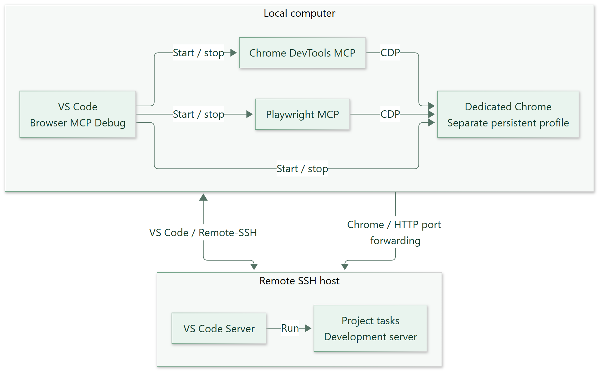
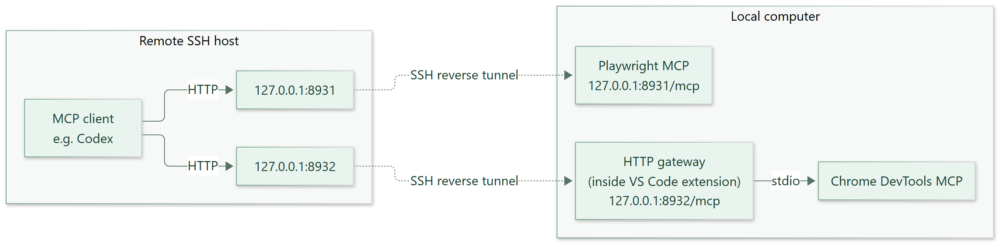

# Browser MCP Debug

**Use Playwright MCP and Chrome DevTools MCP in the same Chrome browser as your VS Code debugger, locally or over Remote-SSH.**

Start a configuration from **Run and Debug** to share one dedicated Chrome between your project's Chrome debugger, Playwright MCP, and Chrome DevTools MCP on your local computer. Both MCP servers stop when debugging ends, so you do not need to start them manually or keep them running in the background.

Use it with existing debug configurations for Angular, React, Vue, Vite, and other web projects. Chrome is the supported browser.

## Features

- Automate browser interactions with Playwright MCP and inspect pages with Chrome DevTools MCP while debugging
- Start and stop both MCP servers alongside an existing debug configuration
- Keep MCP servers and Chrome on your local computer when using Remote-SSH
- Launch a dedicated Chrome with a separate, persistent profile
- Close dedicated Chrome automatically when debugging ends while keeping its profile
- Check startup status in Output and receive notifications for startup failures or unexpected exits

## Connection overview

Install this extension on your local computer, where Chrome and both MCP servers run. With Remote-SSH, project tasks and the development server run on the remote host.



*An example using a debug configuration that starts a development server. The server's startup and shutdown follow that configuration and its tasks.*

## Install and prepare

Extension ID: **`mm-lab.browser-mcp-debug`**. Release packages are distributed from [GitHub Releases](https://github.com/mm-lab-dev/browser-mcp-debug/releases).

In the VS Code Extensions view, open the menu, choose **Install from VSIX...**, and select the supplied VSIX file. When using Remote-SSH, install the extension **locally**, on the computer running VS Code.

You will need:

- Desktop VS Code 1.96 or later
- Node.js, npm, and npx on your local computer; Node.js 22 LTS or later is recommended
- Chrome installed on your local computer
- An existing VS Code debug configuration for your project
- Network access to download the MCP packages on first use

If VS Code cannot find a newly installed Node.js, restart VS Code to refresh its PATH.

### Dedicated Chrome setup

For a Chrome launch target, VS Code launches one dedicated Chrome with remote debugging enabled, opens the target URL, and the extension connects both MCP servers to that same browser. **No manual Chrome remote debugging setup or Playwright browser extension installation is required.**

Chrome uses a separate, persistent profile, so sign in to services separately in that window.

## Add a debug configuration

Open your project's `.vscode/launch.json` and add the following configuration to the `configurations` array. Keep your existing debug configurations.

```json
{
  "name": "Frontend + Browser MCP",
  "type": "browser-mcp",
  "request": "launch",
  "target": "Frontend",
  "browser": {
    "type": "chrome"
  },
  "playwrightMcp": {
    "enabled": true,
    "port": 8931
  },
  "chromeDevtoolsMcp": {
    "enabled": true,
    "port": 8932
  }
}
```

Replace `Frontend` in `target` with the name of your existing **Chrome launch configuration** (`type: "chrome"` or `"pwa-chrome"`, `request: "launch"`). The name must identify exactly one configuration in the same workspace folder.

The target's `url`, `preLaunchTask`, `postDebugTask`, `webRoot`, source maps, and breakpoint settings are preserved. VS Code launches its Chrome locally using the dedicated profile and an automatically assigned CDP port; both MCP servers connect to that browser. The extension does not open a second Chrome window or attach to your usual Chrome. Your launch configuration file is not rewritten.

`type: "browser-mcp"` selects this extension's debugger. The browser is specified by `browser.type`, which currently supports `chrome`.

## Start and stop

1. Open your project in VS Code. With Remote-SSH, open the project on the remote host.
2. Add the configuration above.
3. In **Run and Debug**, select **Frontend + Browser MCP** and choose **Start Debugging**.
4. VS Code runs the target's startup task and opens its URL in dedicated Chrome. Both MCP servers then connect to that same browser. You can use VS Code breakpoints and MCP tools on the same page.

Both MCP servers and dedicated Chrome stop when `target` ends. To stop the whole session, select the parent **Frontend + Browser MCP** session and choose **Stop** in the debug toolbar. The dedicated profile is retained, including saved sign-ins and browser settings.

Check startup status and errors in **Output > Browser MCP**, or run **Browser MCP: Show Output** from the Command Palette.

## Dedicated Chrome options

| Launch option | Default | Description |
| --- | --- | --- |
| `browser.executablePath` | Auto-detected | Absolute path to local Chrome |
| `browser.userDataDir` | Per-workspace local extension storage | Absolute local path to an empty or extension-owned dedicated profile |

The profile is retained between sessions. Close any dedicated Chrome left open from an interrupted session before starting a Chrome launch target. Your usual Chrome profile is kept separate. With Remote-SSH, executable and profile paths refer to your local computer; use an absolute local path rather than a remote workspace path. The debugging port is assigned automatically and listens on loopback.

## Connect an MCP client

Register the following URLs in your MCP client, such as Codex. Both endpoints use Streamable HTTP.

| MCP server | Default URL |
| --- | --- |
| Playwright MCP | `http://127.0.0.1:8931/mcp` |
| Chrome DevTools MCP | `http://127.0.0.1:8932/mcp` |

Start debugging and wait for the MCP servers to report readiness in Output before connecting. Reconnect your client if it attempted to connect before startup, or after the MCP servers restart in a new debug session.

Chrome DevTools MCP is accessed through an HTTP gateway inside this VS Code extension. The gateway translates HTTP tool requests into stdio communication with Chrome DevTools MCP and supports listing and calling tools. It does not forward resources, prompts, or server notifications.

The gateway runs inside the VS Code extension. Playwright MCP connects directly to dedicated Chrome through CDP; no Chrome browser extension is required.

This extension does not register connection settings in your MCP client. If your client runs on the remote host, also complete the Remote-SSH setup below.

## Use with Remote-SSH

Both MCP servers and Chrome run on your local computer, even while VS Code is connected through Remote-SSH. Configure forwarding for the remote MCP client and for Chrome's access to the remote development server separately.



### Forward connections to the MCP servers

You can configure this within VS Code. You do not need to keep a separate SSH command running in a terminal.

1. Open **View > Command Palette** and run **Remote-SSH: Open Configuration File...**.
2. Select the SSH configuration file used for the connection **on your local computer**.
3. Add the two `RemoteForward` lines below to your existing `Host` block and save it. Keep your existing host, user, and key settings.

   ```sshconfig
   Host my-dev-server
       HostName your-remote-host
       User your-user
       RemoteForward 127.0.0.1:8931 127.0.0.1:8931
       RemoteForward 127.0.0.1:8932 127.0.0.1:8932
   ```

   The connection details are examples. In each `RemoteForward` line, the left address is the listener on the remote host; the right address is the MCP endpoint on your local computer.

4. If connected, close the remote connection using the remote indicator in the lower-left corner, then reconnect with **Remote-SSH: Connect to Host...**. Saving the file does not update an existing SSH connection.
5. Open your project, start the Browser MCP debug configuration, and connect your remote MCP client to the URLs listed above.

Ports 8931 and 8932 must be available on the remote host, and the SSH server must allow remote port forwarding. If forwarding is blocked, contact the server administrator. Check connection errors in **Output > Remote - SSH**.

If you change an MCP port, update both sides of its `RemoteForward` line and the client URL to the same port number. See the [OpenSSH RemoteForward specification](https://man.openbsd.org/ssh_config#RemoteForward) for details.

### Open the development server in Chrome

1. In the remote VS Code window, open the **Ports** view in the bottom panel. If it is not visible, run **Ports: Focus on Ports View** from the Command Palette.
2. Choose **Forward a Port** and enter the development server's port, such as `4200`.
3. Copy the displayed local address and open it in the dedicated Chrome window launched by this extension. Use the port number shown by VS Code.

The **Ports** view provides access from your local computer to a remote service. For connections from the remote host to your local MCP servers, use `RemoteForward` as described above. See the [VS Code port forwarding guide](https://code.visualstudio.com/docs/remote/ssh#_forwarding-a-port-creating-ssh-tunnel) for details.

## Settings

Search for `browserMcp` in VS Code Settings to change the defaults. Values in a project's `launch.json` take precedence.

| Setting | Default | Description |
| --- | --- | --- |
| `browserMcp.playwright.command` | `npx` | Command used to start Playwright MCP |
| `browserMcp.playwright.package` | `@playwright/mcp@latest` | Playwright MCP package to run |
| `browserMcp.playwright.defaultPort` | `8931` | Playwright MCP connection port |
| `browserMcp.devtools.command` | `npx` | Command used to start Chrome DevTools MCP |
| `browserMcp.devtools.package` | `chrome-devtools-mcp@latest` | DevTools MCP package to run |
| `browserMcp.devtools.defaultPort` | `8932` | DevTools MCP HTTP connection port |
| `browserMcp.startupTimeout` | `120000` | MCP startup timeout in milliseconds |
| `browserMcp.logging.level` | `info` | Logging detail; also accepts `debug` |

In `launch.json`, you can override each MCP server's `enabled`, `command`, `package`, and `port`, as well as the configuration's `startupTimeout`. Set `enabled: false` for an MCP server you do not need. To pin a version, include the version in its `package` value.

## Troubleshooting

| Problem | What to check |
| --- | --- |
| Node.js or npx cannot be found | Install them on your local computer, then restart VS Code. |
| Dedicated Chrome fails to start | Check that Chrome is installed or set `browser.executablePath`. If specifying `browser.userDataDir`, use an absolute local path to an empty or extension-owned profile. Check Output for details. |
| Startup times out | Check Output. Increase `startupTimeout` if package downloads or Chrome startup need more time. |
| A port is already in use | Check for another running debug session or choose a different MCP port. The extension does not stop the existing port owner. |
| The target cannot be found | Check that exactly one configuration in the same folder's `launch.json` has the matching name. |
| A remote client cannot reach an MCP server | Check `RemoteForward`, reconnect SSH, verify server-side forwarding permissions, and confirm the local MCP server is running. |

## Compatibility and limitations

- Launches dedicated Chrome. Connections to your usual Chrome, Edge, and Firefox are not supported.
- Supports the `launch` debug request. Compounds, another `browser-mcp` configuration as the target, and debug session restarts are not supported.
- One Browser MCP session can run at a time in each VS Code window.
- With a Chrome launch target, VS Code handles the URL and browser breakpoints.
- A Node-only target starts a separate MCP-controlled Chrome at `about:blank`; use MCP tools to navigate. Choose your Chrome launch configuration as the target for Angular component debugging.
- Requires a trusted workspace. VS Code for the Web is not supported.
- Tested with local connections on Windows. Remote-SSH connections, Linux, macOS, and authentication flows have not been verified.

Dedicated Chrome stores browser data in a separate profile for each workspace. A profile can be used by only one Browser MCP session at a time, including sessions in other VS Code windows. To run different workspaces simultaneously, also assign different MCP ports. An explicit `browser.userDataDir` must not be shared by active sessions.

DevTools tools can save snapshots, screenshots, and traces within local workspace folders. In Remote-SSH, files are written on the local computer: use the absolute **DevTools local output directory** shown in **Output > Browser MCP**. Remote workspace paths are not local file destinations. The output directory is retained with the dedicated profile.

MCP tools can interact with the pages and accounts available in that profile. You manage your SSH settings and MCP client configuration.

## Support and license

Report problems through the [GitHub issue tracker](https://github.com/mm-lab-dev/browser-mcp-debug/issues). See [Support](SUPPORT.md) for the information to include and [Changelog](CHANGELOG.md) for release notes.

Browser MCP Debug is released under the [MIT license](LICENSE). Bundled runtime dependency licenses are included in [Third-party notices](THIRD_PARTY_NOTICES.txt). Playwright MCP and Chrome DevTools MCP are separate upstream packages downloaded at runtime.
